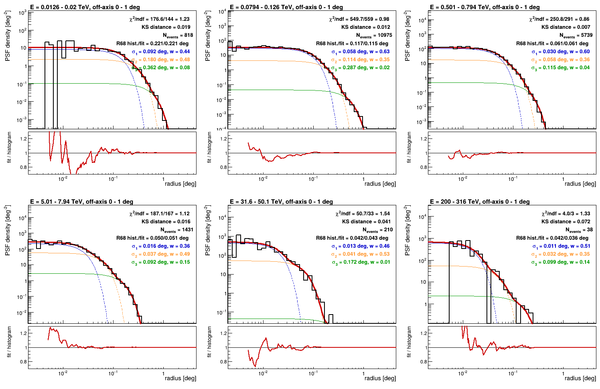

# IRF conversion from CTAO-ROOT to FITS-GDAF format

see [GDAF website](https://gamma-astro-data-formats.readthedocs.io/en/latest/irfs/irf_components/index.html#point-spread-function) for details on the data model.

## Installation

Preferred installation is using docker or apptainer.

Use the prepared docker image to be downloaded from ghcr.io/eventdisplay/converters/dl3-irfs .

Easiest to use it interactively by opening a bash in the corresponding image, e.g.:

```bash
apptainer exec docker://ghcr.io/eventdisplay/converters:latest-dl3-irfs bash
```

Built the docker image on your own:

```bash
docker build -t dl3-irfs .
```

Without docker, all what is needed is a [ROOT](https://root.cern.ch/) and [cfitsio](https://heasarc.gsfc.nasa.gov/fitsio/) installation, and then compile it with:

```bash
make convertSensitivityFilesToFITS
```

## Converting IRFs in ROOT to FITS

General syntax:

```bash
./convertSensitivityFilesToFITS <file.root> <file.fits.gz> 3D
```

(3D option is the default)

Using the docker image discussed above, e.g.:

```bash
$  docker run --rm -it -v "$(pwd)":/workdir \
   ghcr.io/eventdisplay/converters:latest-dl3-irfs \
   /data/Converters/DL3-IRFs/convertSensitivityFilesToFITS \
   /workdir/Prod5-South-20deg-AverageAz-14MSTs37SSTs.180000s-v0.1.root \
   /workdir/Prod5-South-20deg-AverageAz-14MSTs37SSTs.180000s-v0.1.fits.gz \
   3D
```

## Point-spread function

Both PSF HDUs are derived from the radial distributions in `AngularPSF2DEtrue_offaxis`:

- `PSF_TABLE`: the (normalised) radial distributions.
- `PSF_3GAUSS`: a mixture of three 2D Gaussians fitted (binned maximum likelihood) to the same distributions in each true-energy and off-axis bin, on the energy and off-axis grid of `AngularPSF2DEtrue_offaxis`.
  `SCALE` is normalised such that the mixture integrates to one.
  The sigma ratios of the components are smoothed over neighbouring energy bins, as gammapy interpolates the mixture parameters between bins.
  Bins without sufficient statistics (sum of entries <= 10, or fewer than 10 estimated events) are set to zero.

### PSF fit report and plots

For each converted file, the goodness of the `PSF_3GAUSS` fits is printed in the conversion report and written next to the FITS file (use the optional last argument `noplots` to skip this):

- `<name>_psf_fit.csv`: fit parameters and quality of each fitted bin.
- `<name>_psf_fit_offaxis<N>.png`: one plot per off-axis bin with six true-energy bins each: radial PSF density of the histogram and of the fit (with its three components), and the ratio of the enclosed fractions.

Goodness-of-fit metrics (per bin, shown in the plots and in the CSV file):

- `chi2/ndf`: Pearson chi2 of the fit to the radial histogram, with radial bins merged to at least 5 expected events (ndf = bins - 1 - 3 fitted parameters).
  The histogram contents are weighted; the number of events is taken from the histogram errors if stored (`Sumw2`), otherwise estimated as the sum of the contents divided by the smallest filled bin (the weight of a single event).
- `KS distance`: largest difference between the enclosed fractions of fit and histogram.
- `R68 hist./fit`: 68% containment radii.



Fits scatter with the statistics of the histogram: `chi2/ndf` stays close to one (a statistically consistent fit), but the histogram itself (and hence `PSF_TABLE` and the fit) becomes noisy.
The conversion report warns about bins with fewer than 100 events.
[downsample_psf_histogram.C](src/downsample_psf_histogram.C) reduces the statistics of the PSF histogram in a ROOT file for testing, e.g. [10% of the events](docs/psf_fit_10pct_events.png) or [1% of the events](docs/psf_fit_1pct_events.png).

## Testing

Install ogadf tools:

```bash
conda env create -f environment.yml
conda activate dl3irfs
```

To test the converted FITS file, do:

```bash
python src/test_cta_file.py <file.fits.gz>
```

## Notebooks

Some testing notebooks are in the notebook directory. Use `jupyter lab` to run them in a gammapy environment.
